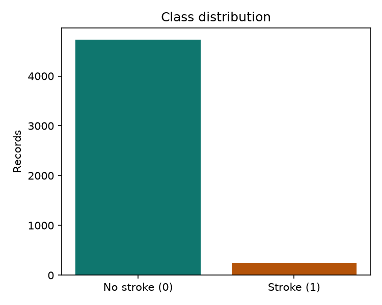
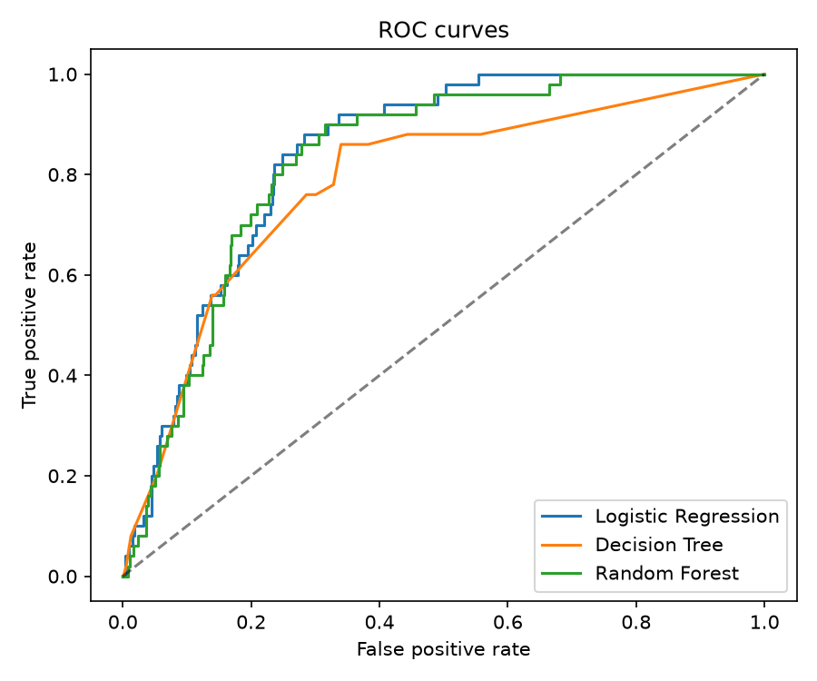

# 🧠 Brain Stroke Prediction

Machine learning project for exploring stroke classification on an imbalanced dataset, with an interactive **Streamlit dashboard** and a **Jupyter notebook** comparing Logistic Regression, Decision Tree, and Random Forest.


> Educational demonstration only. Predictions describe model behavior; they are not a medical diagnosis or a clinically validated estimate of personal stroke risk.

## Overview

The project explores how demographic, health, and lifestyle features relate to the dataset's stroke label. Because stroke cases are the minority class, the notebook uses **balanced class weights**, **stratified cross-validation**, and **recall-based hyperparameter tuning**.

The dashboard lets you try example profiles, compare trained models, inspect feature importance, and explore the trade-off between recall and false positives.

## Features

- **Interactive predictions:** select a model and enter a patient profile.
- **Example profiles and what-if analysis:** explore how changing inputs affects model output.
- **Model comparison:** review accuracy, precision, recall, F1, and ROC-AUC.
- **Threshold study:** inspect Random Forest results across decision thresholds.
- **Feature insights:** view tree feature importance or absolute Logistic Regression coefficients.
- **Visual evaluation:** explore class distribution, age distributions, confusion matrices, and ROC curves.
- **Session history and downloads:** review and export prediction results from the app.

## Dataset

The included [`brain_stroke.csv`](brain_stroke.csv) contains **4,981 records and 11 columns**: ten input features and one target.

| Field | Description |
| --- | --- |
| `gender` | Recorded gender |
| `age` | Age in years |
| `hypertension` | Hypertension indicator |
| `heart_disease` | Heart disease indicator |
| `ever_married` | Marriage history |
| `work_type` | Employment category |
| `Residence_type` | Urban or rural residence |
| `avg_glucose_level` | Average glucose level |
| `bmi` | Body mass index |
| `smoking_status` | Smoking category, including unknown status |
| `stroke` | Target: `0` = no stroke, `1` = stroke |



## Getting started

### 1. Clone the repository

```bash
git clone https://github.com/mithhhilesh/Brain-Stroke-Prediction.git
cd Brain-Stroke-Prediction
python -m venv .venv
```

Activate the environment:

```powershell
# Windows PowerShell
.\.venv\Scripts\Activate.ps1
```

```bash
# macOS / Linux
source .venv/bin/activate
```

### 2. Install dependencies

```bash
python -m pip install --upgrade pip
python -m pip install -r requirements.txt
```

### 3. Launch the dashboard

```bash
python -m streamlit run app.py
```

Open the local URL printed in your terminal, typically **http://localhost:8501**. Choose a model in the sidebar, enter a profile or select an example, and click **Predict stroke class**.

The app loads the saved artifacts from `model_exports/`. Keep this folder alongside `app.py`. Charts and comparison tables are loaded from `assets/`.

## Explore the notebook

Install the additional notebook dependencies:

```bash
python -m pip install jupyter imbalanced-learn
python -m jupyter notebook brain_stroke_prediction_using_lr_dt_rf.ipynb
```

Before running cells, replace the machine-specific dataset path with:

```python
df = pd.read_csv("brain_stroke.csv")
```

Also update each `PROJECT_DIR` to your local repository folder. When launching Jupyter from the repository root, you can use:

```python
PROJECT_DIR = Path.cwd()
```

The notebook includes local export/loading cells. Review these before running everything: the app expects version-2 model dictionaries containing the model pipeline, input metadata, classes, and decision threshold. The checked-in notebook does not include a complete export routine for rebuilding those artifacts.

### Modeling workflow

1. Explore distributions, missing values, and categorical features.
2. Encode categorical inputs.
3. Create a stratified **80:20 train/test split** with `random_state=42`.
4. Tune the three classifiers using **5-fold StratifiedKFold** and **GridSearchCV**, optimizing recall.
5. Evaluate predictions and investigate a lower Random Forest threshold.
6. Generate comparison tables and evaluation plots.

**Imbalance handling:** the active training pipelines use `class_weight="balanced"`. SMOTE is imported, but its resampling cells are commented out.

## Recorded results

The following values come from [`assets/metrics_comparison.csv`](assets/metrics_comparison.csv), using a **0.50 decision threshold**. Precision, recall, and F1 refer to the stroke class.

| Model | Accuracy | Precision | Recall | F1 | ROC-AUC |
| --- | ---: | ---: | ---: | ---: | ---: |
| Logistic Regression | 0.7543 | 0.1505 | 0.8400 | 0.2553 | 0.8405 |
| Decision Tree | 0.7021 | 0.1176 | 0.7600 | 0.2038 | 0.7831 |
| Random Forest | 0.7272 | 0.1373 | 0.8400 | 0.2360 | 0.8293 |

The notebook also reports **0.94 recall** for Random Forest at a **0.25 threshold**, with precision of approximately **0.09**. This illustrates the cost of catching more positive cases: substantially more false positives. The app uses the threshold stored in each selected artifact.

These are recorded project results, not independently reproduced benchmarks. Accuracy alone is insufficient for this imbalanced task, and model scores should not be interpreted as calibrated personal risk.



## Repository structure

```text
Brain-Stroke-Prediction/
├── app.py                                      # Streamlit dashboard
├── brain_stroke.csv                            # Dataset
├── brain_stroke_prediction_using_lr_dt_rf.ipynb # Analysis and training
├── requirements.txt                            # Application dependencies
├── assets/                                     # Metrics tables and evaluation plots
└── model_exports/                              # Saved model artifacts
    ├── stroke_lr.joblib
    ├── stroke_dt.joblib
    ├── stroke_rf.joblib
    └── stroke_model.joblib
```

## Troubleshooting

- **Dependency installation fails:** check the version pins in `requirements.txt` against packages available for your Python version. The setup commands above have not been validated in a fresh environment.
- **Model file is missing or rejected:** confirm the selected model exists in `model_exports/` and uses the version-2 artifact format required by `app.py`.
- **Model loading raises a compatibility error:** use the dependency versions associated with the exported models, or regenerate compatible artifacts with a complete export workflow.
- **Charts or tables are missing:** keep the expected PNG and CSV files in `assets/` beside `app.py`.
- **Notebook cannot find files:** replace the original absolute paths with paths for your own checkout.

## Contributing

Suggestions and improvements are welcome. Open an [issue](https://github.com/mithhhilesh/Brain-Stroke-Prediction/issues) to discuss a change, or submit a pull request with a clear description and relevant validation.

## Author

Created by [Mithhhilesh](https://github.com/mithhhilesh).
